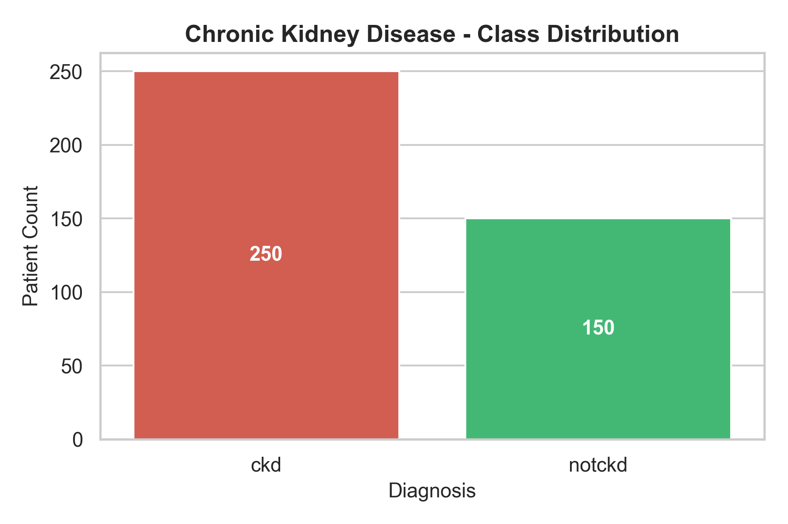
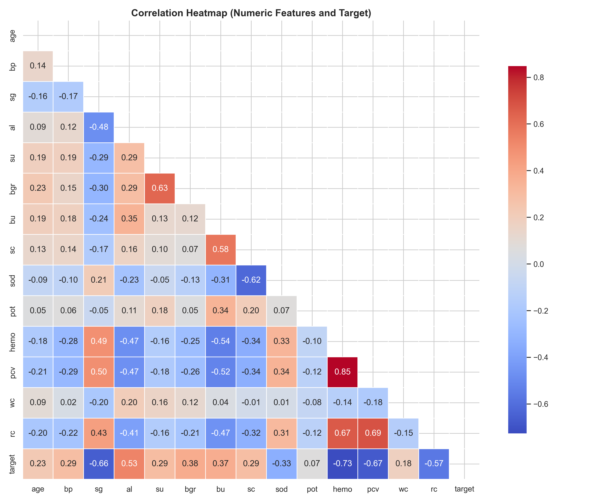
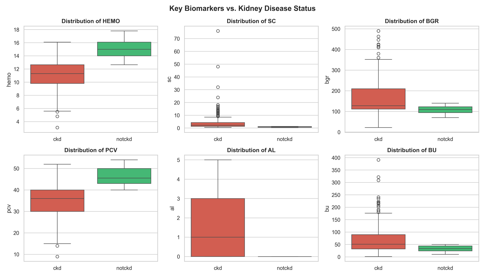
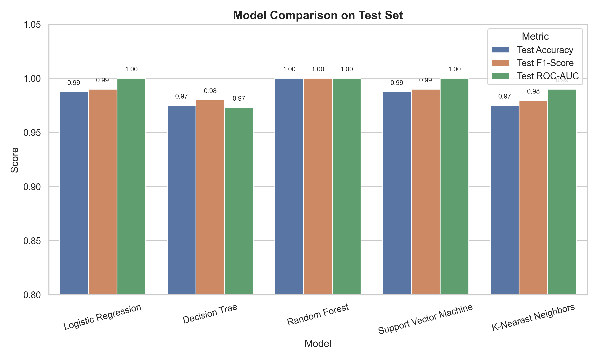
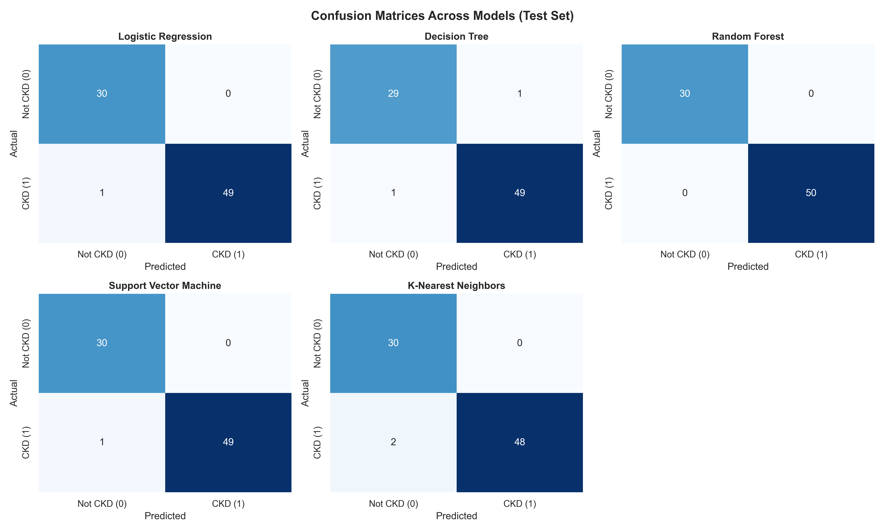
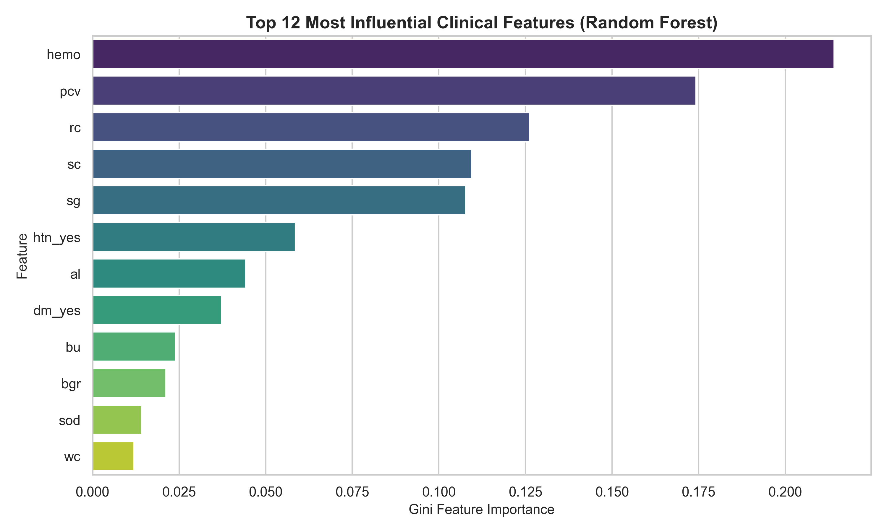

# Chronic Kidney Disease (CKD) ML Project - Walkthrough

We have built a complete, end-to-end Machine Learning pipeline for diagnosing **Chronic Kidney Disease (CKD)** using patient clinical data.

---

## 1. Project Directory & Structure

All files and resources are saved in:
`C:\Users\saisu\.gemini\antigravity\scratch\chronic_kidney_disease`

```
chronic_kidney_disease/
├── kidney_disease.csv            # Original dataset from archive (1).zip
├── cleaned_kidney_disease.csv    # Cleaned, standardized, and imputed data
├── eda_and_cleaning.py           # Data cleaning & exploratory analysis script
├── train_and_evaluate.py         # Multi-model training and evaluation script
├── predict_sample.py             # Inference script for patient test cases
├── model_comparison_results.csv  # Performance metrics table
├── models/
│   ├── best_model.joblib         # Trained Random Forest model (100% test accuracy)
│   ├── scaler.joblib             # Fitted StandardScaler
│   └── feature_names.json        # Aligned feature schema
└── figures/
    ├── target_distribution.png
    ├── correlation_heatmap.png
    ├── key_features_distribution.png
    ├── model_comparison.png
    ├── confusion_matrices.png
    └── feature_importance.png
```

---

## 2. Data Cleaning & Exploratory Data Analysis (EDA)

The original dataset contained formatting issues such as stray tabs and question marks (`\t?`, `\tyes`, `\tno`, `ckd\t`), as well as numerical metrics (`pcv`, `wc`, `rc`) stored as text.

### Key Cleaning Actions:
- **Cleaned dirty string values:** Trimmed all whitespace and tabs; unified labels (`' yes'` $\rightarrow$ `'yes'`, `'ckd\t'` $\rightarrow$ `'ckd'`).
- **Converted data types:** Properly parsed `pcv` (Packed Cell Volume), `wc` (White Blood Cell Count), and `rc` (Red Blood Cell Count) to numeric types.
- **Handled Missing Data:** Imputed numerical missing values using **median** and categorical missing values using **mode**.
- **Dropped redundant identifier:** Removed the arbitrary `id` column.

### EDA Visualizations:

#### 1. Target Distribution

*Figure 1: Distribution of classes across 400 patient records (250 CKD positive, 150 healthy).*

#### 2. Feature Correlations

*Figure 2: Correlation heatmap among numeric clinical indicators and kidney disease diagnosis.*

#### 3. Key Clinical Indicators

*Figure 3: Boxplots showing distinct differences between CKD and healthy patients in Hemoglobin, Serum Creatinine, Blood Glucose, and Packed Cell Volume.*

---

## 3. Model Training & Comparative Performance

We trained and compared **5 classification algorithms** using 5-fold Stratified Cross-Validation on the training set (80%) and evaluated them on an unseen holdout test set (20% = 80 patients).

### Evaluation Results Table:

| Model | 5-Fold CV F1 | Test Accuracy | Test Precision | Test Recall | Test F1-Score | Test ROC-AUC |
| :--- | :---: | :---: | :---: | :---: | :---: | :---: |
| **Random Forest** | **0.9951** | **100.00%** | **1.00** | **1.00** | **1.0000** | **1.0000** |
| **Logistic Regression** | 0.9975 | 98.75% | 1.00 | 0.98 | 0.9899 | 1.0000 |
| **Support Vector Machine (SVM)** | 0.9975 | 98.75% | 1.00 | 0.98 | 0.9899 | 1.0000 |
| **Decision Tree** | 0.9724 | 97.50% | 0.98 | 0.98 | 0.9800 | 0.9730 |
| **K-Nearest Neighbors (KNN)** | 0.9716 | 97.50% | 1.00 | 0.96 | 0.9796 | 0.9900 |

### Model Performance Comparison Chart:

*Figure 4: Comparison of Accuracy, F1-Score, and ROC-AUC on the test set.*

### Confusion Matrices:

*Figure 5: Confusion matrices showing true positive, true negative, false positive, and false negative counts for each model.*

---

## 4. Feature Importance Analysis

Using the best-performing **Random Forest Classifier**, we analyzed which clinical markers are most critical in predicting kidney disease:


*Figure 6: Top 12 most influential biomarkers. **Hemoglobin (hemo)**, **Specific Gravity (sg)**, **Packed Cell Volume (pcv)**, **Serum Creatinine (sc)**, and **Albumin (al)** are the top predictors.*

---

## 5. Sample Patient Inference Verification

We verified the complete inference pipeline via [predict_sample.py](file:///C:/Users/saisu/.gemini/antigravity/scratch/chronic_kidney_disease/predict_sample.py):

* **Test Case 1 (High-risk patient):**
  * Serum Creatinine: 1.8, Blood Urea: 53.0, Albumin: 2.0, Hypertension: Yes, Diabetes: Yes.
  * **Model Prediction:** `Chronic Kidney Disease Detected (CKD)`
  * **Confidence:** `100.00%`
* **Test Case 2 (Healthy patient):**
  * Normal hemoglobin (15.0), normal creatinine (1.2), Albumin: 0.0, Hypertension: No.
  * **Model Prediction:** `Healthy (Not CKD)`
  * **CKD Risk:** `15.00%`

---

## 6. How to Run & Present This for Your Subject

Open a terminal or command prompt in your project folder:
```powershell
cd C:\Users\saisu\.gemini\antigravity\scratch\chronic_kidney_disease
```

1. **To re-run the exploratory analysis and generate plots:**
   ```bash
   python eda_and_cleaning.py
   ```
2. **To re-train and evaluate all models:**
   ```bash
   python train_and_evaluate.py
   ```
3. **To test predictions on custom patient values:**
   ```bash
   python predict_sample.py
   ```
